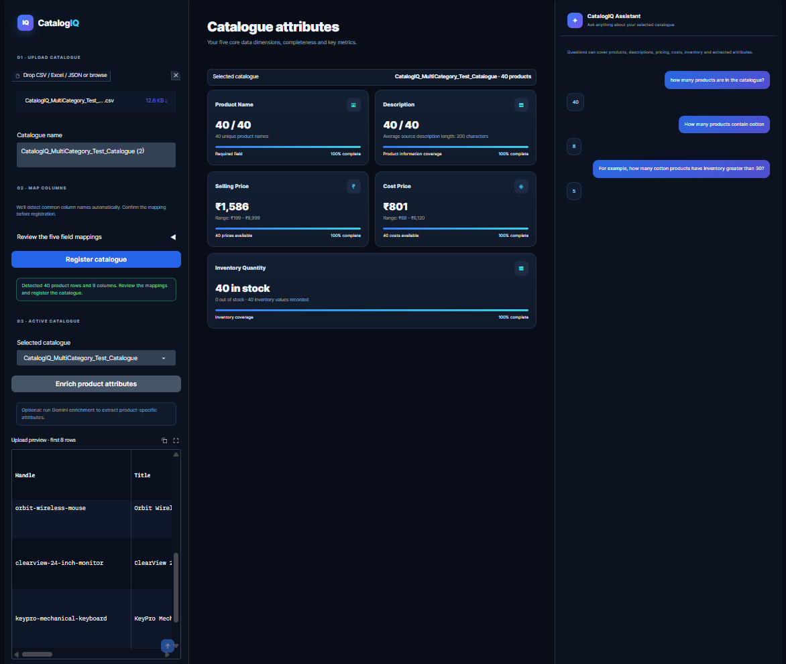
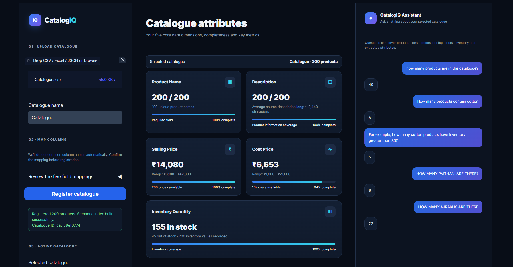
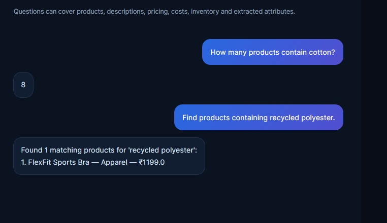
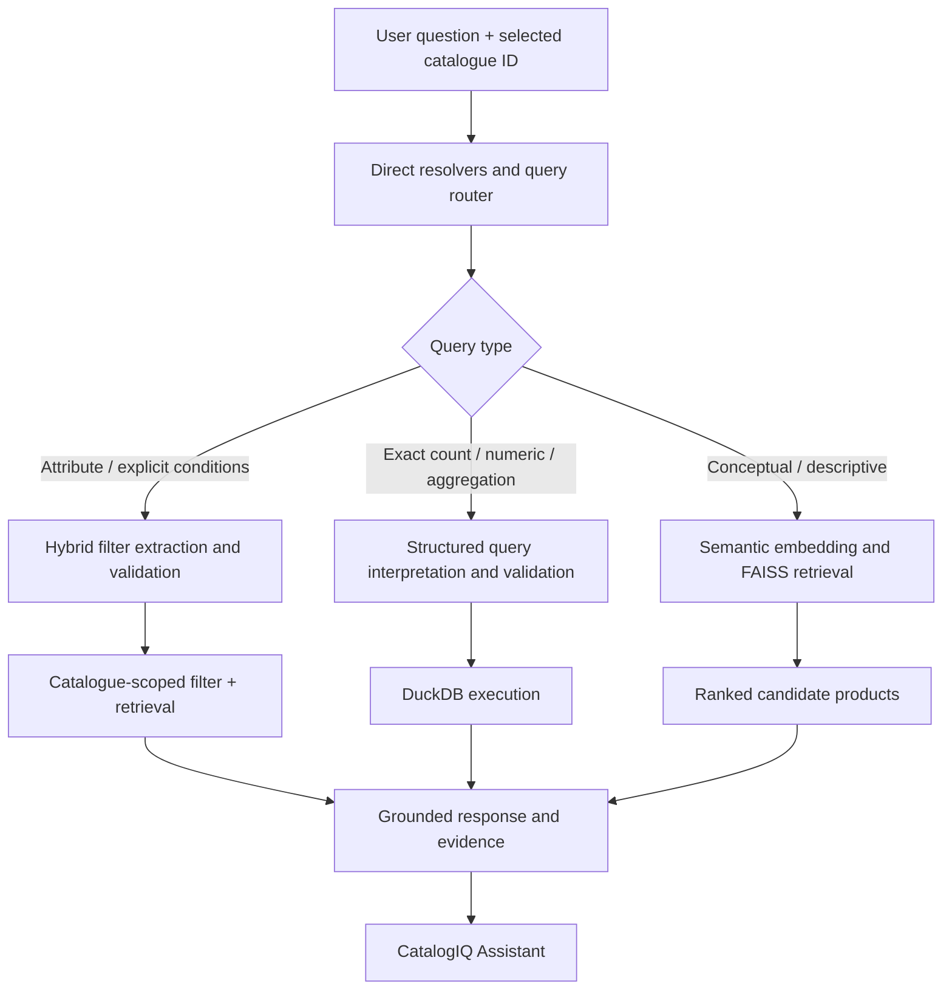

# CatalogIQ — E-commerce Product Intelligence Copilot

> **Turn product catalogues into something teams can ask questions of.**  
> CatalogIQ is an AI-powered product intelligence prototype that combines structured querying, hybrid retrieval, semantic search and evidence-backed answers across multi-category e-commerce catalogues.

<p align="center">
  <strong>AI Product Management · RAG-style retrieval · Hybrid Search · Catalogue Intelligence</strong>
</p>

<p align="center">
  
  
  
  
  
</p>

---

## Welcome — start here

This repository is the **main project hub** for CatalogIQ. It brings together the product story, requirements, system design, evaluation evidence, product decisions and prototype walkthrough in one place.

If you are reviewing CatalogIQ for the first time, follow this path:

1. **Understand the product:** read the overview and problem statement below.
2. **See the experience:** review the dashboard layout and assistant captures.
3. **Understand how it works:** follow the architecture diagram and retrieval explanation.
4. **Review the evidence:** inspect the test results and known limitations.
5. **Go deeper:** open the PRD, architecture, evaluation, decision log and demo guide.

### Project at a glance

| | |
|---|---|
| **Product** | CatalogIQ — E-commerce Product Intelligence Copilot |
| **Product type** | AI / RAG-style product intelligence prototype |
| **Primary problem** | Product information is distributed across titles, descriptions, source metadata, numeric fields and category-specific attributes. |
| **Prototype interface** | Three-panel Gradio dashboard — upload · catalogue dimensions · AI assistant |
| **Demo catalogue** | 40 products across multiple product categories |
| **Enrichment snapshot** | 315 extracted attribute records; all 40 products have at least one extracted attribute |
| **Core data foundation** | Five canonical product fields + preserved source metadata + dynamic attributes |
| **Retrieval** | Structured DuckDB queries · hybrid retrieval · semantic search with Sentence Transformers and FAISS |
| **LLM integration** | Google Gemini for attribute extraction, query interpretation/filter extraction and grounded answer generation |
| **Current status** | Working prototype; documented and evaluated against a small test catalogue; not publicly deployed |
| **Repository visibility** | Private development repository |

> **Important scope note:** 100% product-level enrichment coverage means every product in the 40-item demo has at least one extracted attribute. It does not mean every possible attribute has been captured for every product.

---

## Contents

- [1. What is CatalogIQ?](#1-what-is-catalogiq)
- [2. The problem and product opportunity](#2-the-problem-and-product-opportunity)
- [3. Who is it for?](#3-who-is-it-for)
- [4. Product vision, goals and non-goals](#4-product-vision-goals-and-non-goals)
- [5. Product experience](#5-product-experience)
- [6. How the system works](#6-how-the-system-works)
- [7. Data model: stable core, flexible attributes](#7-data-model-stable-core-flexible-attributes)
- [8. Query and retrieval strategy](#8-query-and-retrieval-strategy)
- [9. Prototype evaluation and test evidence](#9-prototype-evaluation-and-test-evidence)
- [10. Product decision spotlight: the cotton-count investigation](#10-product-decision-spotlight-the-cotton-count-investigation)
- [11. Product metrics and proposed targets](#11-product-metrics-and-proposed-targets)
- [12. Risks, limitations and open questions](#12-risks-limitations-and-open-questions)
- [13. Roadmap](#13-roadmap)
- [14. Documentation library](#14-documentation-library)
- [15. Demo and walkthrough](#15-demo-and-walkthrough)
- [16. Repository map](#16-repository-map)
- [17. Privacy and project status](#17-privacy-and-project-status)
- [18. Product Management perspective](#18-product-management-perspective)

---

## 1. What is CatalogIQ?

CatalogIQ is a natural-language intelligence layer for e-commerce product catalogues. It is designed to help catalogue, category and operations teams ask questions about their product data without first needing to know which file, column or attribute contains the answer.

Instead of manually filtering multiple spreadsheets or relying on exact product-title keywords, a user can ask questions in plain language, for example:

- “How many products contain cotton?”
- “Find products containing recycled polyester.”
- “How many products have inventory greater than 30?”
- “How many cotton products have inventory greater than 30?”
- “Which products have removable pads?”
- “Find products with adjustable features.”

CatalogIQ combines three complementary query paths:

- **Structured querying** for supported exact counts, numeric filters and aggregations.
- **Hybrid retrieval** for explicit attribute and condition-based product discovery.
- **Semantic retrieval** for descriptive or conceptual discovery when users do not use the exact wording found in the catalogue.

The design principle is simple: **use the language model to help understand the question, use retrieval to find relevant evidence, and use the database for supported exact calculations.**

### What the prototype aims to demonstrate

- A consistent data foundation across different product categories.
- Dynamic discovery of product attributes rather than a fixed category-specific keyword list.
- Search across product titles, descriptions, original source metadata and extracted attributes.
- A clear distinction between verified counts and relevance-ranked candidate lists.
- Catalogue-scoped retrieval so the selected catalogue determines which records can be returned.

---

## 2. The problem and product opportunity

E-commerce product information often looks structured but is not consistently discoverable. Useful information may be spread across:

- Product titles and descriptions.
- Tags, variants and other original source metadata.
- Numeric values such as selling price, cost and inventory.
- Category-specific details such as materials, ingredients, dimensions, features, finish or compatibility.

This creates a discovery problem: users know *what* they want to find, but may not know *where* the information lives or how each catalogue represents it.

For example, a search for “cotton” that checks only the product title can miss products where cotton appears in the description or original source metadata. Semantic search may surface relevant candidates, but a ranked shortlist should not automatically be reported as an exact catalogue-wide count. Commercial questions may also combine text conditions with numeric filters.

### Product opportunity hypothesis

**Hypothesis:** If users can ask natural-language questions and receive answers grounded in product records, extracted attributes and deterministic calculations, they can discover catalogue information with less manual spreadsheet filtering and less dependence on knowing the source schema.

This prototype validates core technical workflows. Time saved, user adoption and business impact have **not yet been measured with end users**.

---

## 3. Who is it for?

| Intended user | Job to be done | Example question |
|---|---|---|
| **Catalogue Manager** | Understand catalogue completeness and discover product attributes. | “Which products have recycled polyester?” |
| **Category / Merchandising Manager** | Filter and compare products using category-specific details. | “Show products made from cotton.” |
| **E-commerce Operations Manager** | Investigate stock, pricing and catalogue quality. | “How many products have inventory below 10?” |
| **Marketplace Operations** | Find products that meet listing or merchandising requirements. | “Which products have removable pads?” |

These are intended user segments for the prototype, not validated personas from completed user research.

---

## 4. Product vision, goals and non-goals

### Product vision

Make product catalogues easier to understand and act on by allowing teams to ask questions in natural language while keeping answers tied to catalogue evidence.

### Prototype goals

1. Accept common catalogue files and support source-column mapping.
2. Normalize five stable product fields across categories.
3. Preserve source-specific metadata rather than discarding unmapped fields.
4. Extract dynamic product attributes with supporting evidence.
5. Support structured, hybrid and semantic question types.
6. Use deterministic database operations for supported exact calculations.
7. Scope record, attribute and vector retrieval to the selected catalogue.
8. Present the workflow through a simple three-panel interface.

### Non-goals for the current prototype

- Production multi-tenant SaaS, billing or account management.
- Automated write-back to an e-commerce platform.
- Autonomous pricing or inventory changes.
- Guaranteed interpretation of every unrestricted natural-language question.
- Customer production-data onboarding.
- Guaranteed long-term persistence for newly uploaded catalogues in a hosted environment.
- GPU-dependent inference or model fine-tuning.
- Public deployment in the current portfolio-documentation phase.

---

## 5. Product experience

The original CatalogIQ dashboard is organized around three connected work areas.

### Actual CatalogIQ dashboard



*Actual application capture showing catalogue upload, column mapping, the five catalogue dimensions, inventory information and the CatalogIQ Assistant.*

### CatalogIQ query results



*CatalogIQ answering natural-language questions using catalogue data.*

### The three-panel workflow

| Panel | Purpose | Main actions |
|---|---|---|
| **Left — Upload and setup** | Bring a catalogue into the workspace. | Upload CSV / Excel / JSON, preview rows, map source columns, register or select a catalogue, initiate enrichment. |
| **Centre — Catalogue dimensions** | Understand the selected catalogue's core data foundation. | Review the five canonical dimensions and the summary/completeness information available in the prototype. |
| **Right — CatalogIQ Assistant** | Ask questions about the selected catalogue. | Submit natural-language questions and review answers or retrieved product evidence. |


*This is a layout schematic for orientation, not a screenshot of the live application. The implemented Gradio dashboard follows this left / centre / right structure. [View the editable SVG](assets/dashboard-layout.svg).*

### Actual assistant interaction



*Actual prototype capture: “How many products contain cotton?” returned 8; the recycled-polyester query returned FlexFit Sports Bra as one matching product.*

### Primary user journey

1. Upload a CSV, Excel or JSON catalogue.
2. Review the proposed mappings for the five canonical fields.
3. Register the catalogue and preserve its original source data.
4. Run attribute enrichment to discover catalogue-specific product details.
5. Select the catalogue to query.
6. Ask a question in the AI assistant.
7. Review the answer and, where applicable, product evidence/cards.

---

## 6. How the system works

CatalogIQ separates presentation, ingestion, storage, enrichment, retrieval and answer generation. This makes it possible to improve one layer without making the entire product depend on a single LLM call.

### High-level architecture


*The diagram shows the major components and the flow from source catalogue to grounded answer. [View the editable SVG](assets/catalogiq-architecture.svg).*

### Architecture in plain language

#### A. Catalogue ingestion and normalization

The user uploads a catalogue file. The ingestion workflow reads the rows, validates the file, previews the data and proposes mappings from source columns to five canonical fields. Original source information is retained separately so tags, variants and category-specific fields are not lost during normalization.

#### B. Attribute enrichment

The Gemini-powered extraction pipeline examines product information and discovers product-specific attributes. Extracted values are validated against source evidence before being stored. This keeps the attribute model flexible across apparel, beauty, electronics, home and other categories instead of requiring every possible attribute to be defined in advance.

#### C. Storage and indexing

- **DuckDB** stores the catalogue registry, canonical product records and related attribute records.
- **Sentence Transformers** creates vector embeddings from product information.
- **FAISS CPU** builds a vector index for each catalogue so semantic search can retrieve relevant candidates within the selected catalogue.

The current development workflow can rebuild the semantic indexes from stored catalogue records; the index is a runtime artifact rather than the only copy of product data.

#### D. Query orchestration

A user question and selected `catalogue_id` enter the query engine. Deterministic resolvers and a query router help direct the question to the appropriate retrieval path: structured, hybrid or semantic.

#### E. Answer generation and evidence

The answer-generation layer formats retrieval output into a natural-language response. Where the complete matching set is deterministically verified, the system can report an exact matching count. Where retrieval returns a relevance-ranked shortlist, the response should be understood as candidate results—not as an exact catalogue-wide total.

### Architecture component map

| Component | Responsibility |
|---|---|
| Gradio dashboard | Upload, mapping, catalogue selection, five-dimension overview and assistant chat. |
| Ingestion / mapping | Read source files, validate data and map source columns to canonical fields. |
| DuckDB | Store catalogue registry, product records and extracted attribute records. |
| Attribute extractor | Use Gemini to discover attributes and retain supporting evidence. |
| Query router | Select structured, hybrid or semantic retrieval. |
| Query interpreter | Convert a natural-language question into a validated query specification. |
| Query executor | Validate and execute supported deterministic SQL operations. |
| Hybrid retriever | Combine explicit conditions and catalogue-scoped retrieval. |
| Semantic search manager | Build and query catalogue-specific FAISS indexes from Sentence Transformer embeddings. |
| Answer generator | Produce a natural-language response grounded in retrieval output. |

### Query lifecycle



---

## 7. Data model: stable core, flexible attributes

CatalogIQ uses five canonical fields as the stable product foundation:

| Canonical field | Purpose |
|---|---|
| `product_title` | Product name or title. |
| `product_description` | Product description and descriptive text. |
| `selling_price` | Customer-facing selling price. |
| `cost_price` | Product cost. |
| `inventory_quantity` | Inventory quantity. |

Two additional structures preserve flexibility:

- **`source_record_json`** retains original source fields that do not map to the five canonical fields.
- **Extracted catalogue attributes** store product association, attribute name, value, supporting evidence, extraction model and timestamp (where available in the schema).

### Why not add every attribute as a database column?

A fixed schema for every possible product feature would become difficult to maintain across categories. A saree catalogue, beauty catalogue and electronics catalogue may have very different product attributes. Keeping a stable canonical core and storing dynamic attributes separately allows the product to adapt to different catalogues.

### The virtual `product_text` search scope

The virtual **`product_text`** field is a search abstraction that searches across:

- Product title.
- Product description.
- Original source metadata.
- Extracted attribute names, values and supporting evidence.

It is **not** a sixth persisted canonical database column. It was introduced to prevent general product/attribute searches from being restricted to the title field.

---

## 8. Query and retrieval strategy

Different user questions need different retrieval strategies. CatalogIQ does not treat every question as a semantic-search problem.

| Retrieval path | What it does | Best suited for | How to interpret the result |
|---|---|---|---|
| **Structured** | Interprets and validates a query specification, then executes deterministic filters or aggregations in DuckDB. | Supported exact counts, averages/sums, numeric conditions and missing-value queries. | Exact when the query is valid and executed over the complete selected-catalogue match set. |
| **Hybrid** | Extracts and validates explicit conditions, then combines catalogue filters with retrieval. | Attribute-oriented questions and combinations of text and record conditions. | Exact count only when the full match set and filter semantics are verified; otherwise treat results as a shortlist. |
| **Semantic** | Embeds the question and retrieves relevance-ranked candidates from the selected catalogue's FAISS index. | Conceptual or descriptive discovery when the user's wording may not exactly match catalogue wording. | Candidate ranking, not an exact match count by itself. |

### Grounding principle

DuckDB is the source of truth for supported exact calculations. Semantic similarity alone is not proof of an exact match. The system should state when it can verify a total and when it can only provide relevant candidates.

---

## 9. Prototype evaluation and test evidence

The current evaluation uses one curated 40-product, multi-category catalogue. The results below are observed prototype outcomes, not production benchmarks or third-party validation.

### Functional test snapshot

| Test question | Observed result | What was verified |
|---|---:|---|
| How many products are in the catalogue? | **40** | Structured catalogue count. |
| How many products contain cotton? | **8** | Cross-field count; verified through the direct executor and complete application. |
| How many products contain recycled polyester? | **1** | FlexFit Sports Bra retrieved. |
| How many fragrance-free products are there? | **3** | Three products returned by the tested attribute workflow. |
| How many products have inventory greater than 30? | **25** | Structured numeric count. |
| How many cotton products have inventory greater than 30? | **5** | Combined text and numeric filter. |
| Which products have removable pads? | **1** | FlexFit Sports Bra retrieved. |
| Which products have adjustable features? | **5 retrieved** | Five candidates returned; catalogue-wide completeness was not independently certified. |

### Enrichment snapshot

| Measure | Observed result |
|---|---:|
| Products in curated catalogue | 40 |
| Products with at least one extracted attribute | 40 |
| Extracted attribute records | 315 |
| Product-level enrichment coverage | 100% |

### Catalogue-isolation spot check

A separate 200-product development catalogue was used for a limited isolation spot check. It is not included in the curated 40-product case-study dataset.

| Check | 40-product catalogue | Separate 200-product catalogue |
|---|---:|---:|
| Product count returned | 40 | 200 |
| FlexFit Sports Bra records | 1 | 0 |

These spot checks show that the tested query paths respected the selected catalogue ID. They are not a complete security certification or exhaustive multi-tenant test suite.

### Resilience observation

During one regression run, Gemini returned a transient 503 response. The bounded retry logic retried the request and the application subsequently returned the expected cotton count of 8. This is one observed recovery case, not a comprehensive availability or load test.

For individual test cases, conditions and known gaps, see [Evaluation & Test Evidence](docs/EVALUATION.md).

---

## 10. Product decision spotlight: the cotton-count investigation

One of the most useful prototype findings came from a seemingly simple question:

> **“How many products contain cotton?”**

### What happened

1. The initial query interpretation mapped “contains cotton” to `product_title` only and returned **2**.
2. A source-level audit found **8** products with cotton evidence across product titles, descriptions or original source metadata.
3. Seven distinct products had a cotton-related extracted attribute; the eighth remained discoverable from original source text.
4. The team introduced a virtual `product_text` search scope and updated the interpreter to use it for general product/attribute searches.
5. The direct executor and full CatalogIQ application then returned **8**.

### Product lesson

Extracted attributes should complement original source evidence, not become the only source of truth. The issue also reinforced the need to evaluate query interpretation separately from retrieval and execution.

### Why this mattered

The problem was not a failure of the database count operation. It was a mismatch between the user's intent and the field selected by the query interpreter. Fixing the interpretation and search scope improved the product's behaviour without adding “cotton” as a special hardcoded category rule.

See [Product & Architecture Decision Log](docs/DECISIONS.md), decision D-05, for the associated design rationale.

---

## 11. Product metrics and proposed targets

The prototype has functional test evidence, but it does not yet have instrumented end-user usage data. The following are **proposed initial targets**, not achieved production metrics.

| Metric | Definition | Proposed initial target |
|---|---|---:|
| Exact count accuracy | Correct exact-count responses / labelled count tests | ≥95% |
| Filter correctness | Correctly included/excluded records / evaluated records | ≥95% |
| Retrieval Precision@5 | Relevant products in the top five / five | ≥80% |
| Attribute evidence validity | Audited attributes with valid source evidence / attributes audited | ≥98% |
| Catalogue isolation pass rate | Passed isolation checks / isolation checks executed | 100% |
| Supported-query completion rate | Successful supported queries / supported query attempts | ≥95% |
| Median response latency | Median time from submit to answer | Establish a baseline first |
| Cost per successful query | LLM and infrastructure cost / successful queries | Establish a baseline first |

### Proposed north-star metric

**Evidence-backed Catalogue Question Success Rate** — the percentage of supported user questions that return a correct answer with traceable catalogue evidence.

Before using this as a formal KPI, the team would need a labelled evaluation set and clear rules for what counts as a successful response.

---

## 12. Risks, limitations and open questions

CatalogIQ is a portfolio prototype, not a production-ready multi-tenant SaaS product. The following gaps remain:

- The core evaluation is based on one 40-product multi-category catalogue and a small set of manually executed tests.
- Hybrid and semantic retrieval need a larger labelled evaluation set to measure precision, recall and ranking quality.
- Some semantic results are candidates; they must not be represented as exact totals without deterministic verification.
- Attribute extraction coverage does not guarantee every possible attribute was captured.
- Gemini availability, quotas and model behaviour can affect interpretation, extraction and answer generation.
- Structured questions still use LLM-assisted interpretation in the current end-to-end flow; a deterministic parser for common query patterns remains a potential improvement.
- Authentication, authorization, rate limiting, auditability, observability, backup/restore and production data governance require further design.
- Persistence and retention for user-uploaded catalogues need an explicit deployment strategy.
- Larger catalogues and concurrent workloads need performance testing before infrastructure sizing decisions.
- There is no live public deployment in the current project phase.

---

## 13. Roadmap

| Priority | Workstream | Intended outcome |
|---|---|---|
| **P0** | Portfolio documentation and demo assets | Complete the product hub, PRD, architecture, evaluation, screenshots and Loom walkthrough. |
| **P1** | Broader evaluation | Build a labelled test set across catalogues, categories and query types. |
| **P1** | Retrieval reliability | Validate hybrid completeness, semantic ranking quality and combined filters. |
| **P1** | Runtime resilience | Test prolonged Gemini outages, quota limits, malformed responses and recovery. |
| **P2** | Multi-catalogue hardening | Expand isolation tests for concurrent requests, edge cases and unauthorized catalogue IDs. |
| **P2** | Operational readiness | Define persistence, retention, access controls, logs, backup and restore. |
| **Later** | Controlled live demo | Revisit hosting only when cost, privacy and data-persistence requirements are clear. |

---

## 14. Documentation library

This README is the overview. The following documents provide the detailed project record.

| Document | What it covers | Start here when you want to… |
|---|---|---|
| [Product Requirements Document](docs/PRD.md) | Problem, users, jobs to be done, goals, non-goals, MVP scope, functional/non-functional requirements and proposed metrics. | Understand the product rationale and requirements. |
| [System Architecture](docs/ARCHITECTURE.md) | Components, canonical data model, query lifecycle, retrieval modes, catalogue isolation and operational considerations. | Understand how the system is designed. |
| [Evaluation & Test Evidence](docs/EVALUATION.md) | Test cases, observed results, coverage interpretation, limitations and proposed evaluation targets. | Review what has actually been tested. |
| [Product & Architecture Decision Log](docs/DECISIONS.md) | Decisions, rationale, trade-offs and follow-through. | Understand why the product was built this way. |
| [Demo Walkthrough Guide](docs/DEMO_GUIDE.md) | Suggested walkthrough, demo questions and capture checklist. | Review or record the product demo. |

### Visual assets

| Asset | Description |
|---|---|
| [Actual CatalogIQ dashboard PNG](assets/catalogiq-dashboard.png) | Real multi-category catalogue dashboard capture. |
| [System architecture PNG](assets/catalogiq-architecture.png) | Rendered system architecture diagram. |
| [System architecture SVG](assets/catalogiq-architecture.svg) | Editable vector version of the architecture diagram. |
| [Dashboard layout PNG](assets/dashboard-layout.png) | Three-panel UI schematic. |
| [Dashboard layout SVG](assets/dashboard-layout.svg) | Editable vector version of the dashboard schematic. |
| [Assistant results PNG](assets/assistant-results.png) | Actual prototype assistant capture showing two tested questions. |
| Query results | `assets/catalogiq-query-results.png` | Example of natural-language catalogue querying |

---

## 15. Demo and walkthrough

### Loom walkthrough

[▶ Watch the CatalogIQ product walkthrough on Loom](https://www.loom.com/share/8ea6cb1ed4544213933ca1a5e667cfd1)

The walkthrough demonstrates the working multi-category catalogue experience, including catalogue upload, column mapping, catalogue dimensions and natural-language questions in the CatalogIQ Assistant.

### Screenshot checklist

The current visual assets include a dashboard layout schematic and an actual assistant capture. Additional real application screenshots can be added after reviewing them for private information:

- `assets/catalogiq-dashboard.png` — actual full dashboard screenshot included in this repository.
- `assets/catalogue-upload.png` — upload and column-mapping panel.
- `assets/catalogue-dimensions.png` — five canonical dimensions panel.
- `assets/loom-thumbnail.png` — thumbnail linked to the Loom walkthrough.

Do not label a schematic as a live application screenshot.

---

## 16. Repository map

```text
CatalogIQ/
├── README.md                         # Main product hub and portfolio overview
├── app.py                            # Development application entry point
├── catalogiq_simple_dashboard.py     # Original three-panel Gradio dashboard
├── requirements.txt                  # Python dependencies
├── Procfile                          # Startup command retained from deployment exploration
├── .python-version                   # Python runtime pin
├── catalogiq.duckdb                  # Development database — keep private
├── src/
│   └── src/                          # Python source modules in the current repository layout
├── docs/
│   ├── PRD.md                        # Product requirements
│   ├── ARCHITECTURE.md               # System design and query/data flows
│   ├── EVALUATION.md                 # Test cases, outcomes and gaps
│   ├── DECISIONS.md                  # Product and architecture decisions
│   └── DEMO_GUIDE.md                 # Walkthrough guide
└── assets/
    ├── catalogiq-architecture.png
    ├── catalogiq-architecture.svg
    ├── dashboard-layout.png
    ├── dashboard-layout.svg
    └── assistant-results.png
```

*The tree reflects the current development repository layout. Local runtime configuration and the development database are not intended as a ready-to-run public distribution.*

---

## 17. Privacy and project status

- The implementation repository is private during the current portfolio-documentation phase.
- Do not commit Gemini API keys, `.env` files, credentials, personal information or unapproved catalogue data.
- The curated 40-product test catalogue is the dataset intended for approved portfolio examples in this documentation.
- A separate 200-product development catalogue and an older duplicate catalogue are excluded from the curated demo scope.
- Review screenshots and Loom recordings before sharing; browser account details, secrets and private data must not be visible.
- Any future public release requires a deliberate review of source code, dataset permissions, Git history, licensing and access control.
- No public app URL is provided because deployment is not part of the current phase.

---

## 18. Product Management perspective

CatalogIQ is intended to demonstrate more than implementation. It records the product thinking behind an AI-enabled workflow:

- **Problem framing:** identify the catalogue discovery friction rather than starting with a model choice.
- **User and workflow thinking:** connect upload, mapping, enrichment, question answering and evidence review into one journey.
- **Technical product judgment:** separate exact database calculations from hybrid and semantic candidate retrieval.
- **Data-model decisions:** keep five canonical fields stable while preserving source metadata and dynamic attributes.
- **Evaluation mindset:** distinguish measured prototype outcomes from proposed KPI targets and unverified assumptions.
- **Trade-off management:** document retry behaviour, model dependency, catalogue isolation, CPU-first design and persistence gaps.
- **Iterative problem-solving:** investigate the cotton-count discrepancy, identify the title-only interpretation issue, introduce cross-field search and verify the corrected result.

**Current positioning:** a working, technically tested AI product prototype with documented product requirements, architecture, evaluation evidence, trade-offs and a roadmap—not a claim of production readiness or proven business impact.

---

*For a structured review, start with the [PRD](docs/PRD.md), continue to the [Architecture](docs/ARCHITECTURE.md), then review the [Evaluation](docs/EVALUATION.md) and [Decision Log](docs/DECISIONS.md).*
