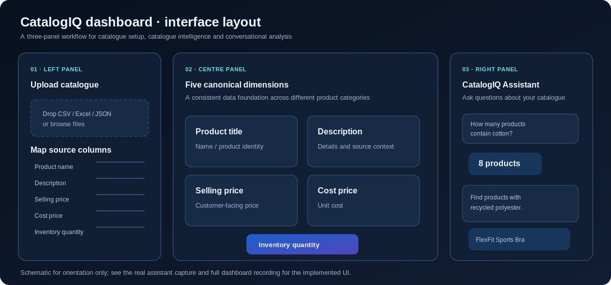
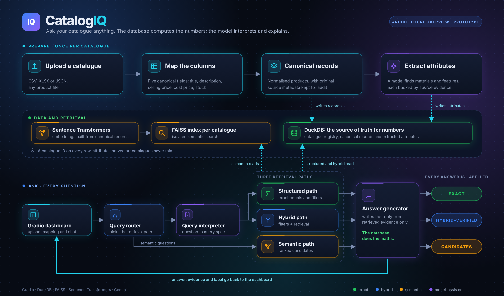

# CatalogIQ — E-commerce Product Intelligence Copilot

> **An AI product-management case study and working prototype for natural-language product-catalogue intelligence.**  
> Explore a catalogue, ask questions in plain language, and inspect answers grounded in product records and extracted attributes.

**Project type:** AI / RAG product prototype  
**Current status:** Core prototype built and tested; not publicly deployed  
**Demo scope:** 40 products across multiple categories · 315 extracted attribute records  
**Interface:** Three-panel Gradio dashboard  
**Repository:** Private development repository; public deployment is intentionally out of scope for this phase

---

## Start here

CatalogIQ is documented as a product, not just as a code repository. This README is the entry point; the linked documents go deeper into requirements, architecture, evaluation and product decisions.

| Read this | What you will learn |
|---|---|
| [Product Requirements Document](docs/PRD.md) | Problem framing, users, use cases, scope, requirements, risks and acceptance criteria. |
| [System Architecture](docs/ARCHITECTURE.md) | Data model, ingestion, enrichment, query orchestration, retrieval paths and catalogue isolation. |
| [Evaluation & Test Evidence](docs/EVALUATION.md) | Test cases, observed results, known gaps and proposed quality targets. |
| [Product & Architecture Decision Log](docs/DECISIONS.md) | Why key decisions were made and the trade-offs they introduce. |
| [Demo Walkthrough Guide](docs/DEMO_GUIDE.md) | Suggested product walkthrough, questions to demonstrate and screenshot checklist. |

**Suggested reading path:** README → PRD → Architecture → Evaluation → Decision Log → Demo Guide.

---

## 1. What is CatalogIQ?

CatalogIQ is a natural-language intelligence layer for e-commerce product catalogues. It helps catalogue, category and operations teams ask questions about products without first needing to know which source column contains the answer.

A user can ask questions such as:

- “How many products contain cotton?”
- “Find products containing recycled polyester.”
- “How many products have inventory greater than 30?”
- “How many cotton products have inventory greater than 30?”
- “Which product has removable pads?”

The prototype combines **structured database queries, hybrid retrieval and semantic search**. It uses an LLM to help interpret natural-language questions and extract product-specific attributes, while DuckDB remains the source of truth for supported exact calculations.

### At a glance

| Area | Current prototype |
|---|---|
| Product problem | Product information is spread across titles, descriptions, source metadata, numeric fields and category-specific attributes. |
| Product concept | A catalogue-aware assistant that turns natural-language questions into validated retrieval and query operations. |
| Primary users | E-commerce operations teams, catalogue managers, category managers and marketplace teams. |
| Core data model | Five canonical fields, with original source metadata and dynamic attributes retained separately. |
| Demo data | One curated, multi-category catalogue containing 40 products. |
| Enrichment | 315 extracted attribute records; all 40 products have at least one extracted attribute. |
| Retrieval | Structured DuckDB queries, hybrid retrieval, and semantic search with Sentence Transformers + FAISS. |
| LLM integration | Google Gemini API for attribute extraction, question interpretation/filter extraction and grounded answer generation. |
| UI | Original three-panel Gradio dashboard: upload · catalogue dimensions · AI assistant. |

> **Scope note:** 100% product-level enrichment coverage means each of the 40 products has at least one extracted attribute. It does not mean every possible attribute has been captured for every product.

---

## 2. The problem we're solving

Product catalogues look structured from the outside, but useful product knowledge is often fragmented across different places:

- Product title and description fields.
- Original source columns, tags, variants and metadata.
- Numeric values such as selling price, cost and inventory.
- Category-specific product attributes such as material, ingredients, features, finish or compatibility.

This fragmentation creates a discovery problem. A user may know *what* they want to find, but not *where* that information lives in the catalogue.

For example, a title-only search for “cotton” can miss products where cotton appears only in the description or source metadata. A semantic search can surface relevant candidates, but a ranked shortlist should not automatically be presented as an exact catalogue-wide count. Commercial questions may also combine text conditions with numeric filters.

### Product opportunity

**Hypothesis:** If users can ask catalogue questions in natural language and receive answers grounded in source records, extracted attributes and deterministic calculations, they can discover product information with less manual spreadsheet filtering and less dependence on knowing the catalogue schema.

This is a product hypothesis. The prototype validates core workflows technically; time saved and business impact have not yet been measured with end users.

---

## 3. Who is it for?

| User segment | Job to be done | Example question |
|---|---|---|
| Catalogue manager | Understand catalogue completeness and find product attributes. | “Which products have recycled polyester?” |
| Category manager | Compare or filter products using category-specific details. | “Show products made from cotton.” |
| E-commerce operations | Investigate inventory and catalogue quality. | “How many products have inventory below 10?” |
| Marketplace operations | Find products matching merchandising or listing requirements. | “Which products have removable pads?” |

These are intended user segments for the prototype, not validated customer personas from user research.

---

## 4. Product experience

The original dashboard has three connected work areas:

1. **Left — Upload and setup:** Upload CSV, Excel or JSON; inspect a preview; map source columns to canonical fields; register or select a catalogue; and initiate attribute enrichment.
2. **Centre — Catalogue dimensions:** Review the five canonical data dimensions and the catalogue-level completeness/summary information available in the prototype.
3. **Right — AI assistant:** Ask natural-language questions and review answers or matching product evidence.

### Interface layout



*This is a layout schematic, not a screenshot. It explains the structure of the implemented Gradio dashboard. [View the editable SVG source](assets/dashboard-layout.svg).*

### Actual prototype interaction


*Actual assistant-panel capture from the prototype: the cotton count returned 8, and the recycled-polyester query retrieved FlexFit Sports Bra.*

### Product walkthrough

**Loom walkthrough:** *To be recorded.*  
The planned 4–6 minute walkthrough is outlined in [the demo guide](docs/DEMO_GUIDE.md). Add the Loom URL here after recording and reviewing it for sensitive information.

`<!-- Replace with: [Watch the CatalogIQ walkthrough](YOUR_LOOM_URL) -->`

---

## 5. How the system works

CatalogIQ is designed as a layered system. The diagram below shows the major components and how catalogue data and user questions move through them.



### Architecture explained, layer by layer

#### A. Catalogue ingestion and normalisation

The user uploads a CSV, Excel or JSON catalogue. The ingestion workflow validates the file, previews rows and helps map source columns to five stable canonical fields. Original source information is retained separately so that tags, variants and category-specific fields are not discarded during normalisation.

#### B. Attribute enrichment

The Gemini-powered extraction pipeline reads product information and discovers product-specific attributes. Extracted values are checked against supporting source evidence before they are stored. This keeps the attribute model flexible across product categories instead of requiring every possible attribute to be added to a fixed schema.

#### C. Storage and semantic indexing

DuckDB stores the catalogue registry, canonical product records and related attribute records. A Sentence Transformer model converts product information into embeddings, and FAISS provides a catalogue-specific vector index for semantic retrieval. The current development workflow can rebuild these indexes from stored catalogue records.

#### D. Query orchestration

A user question is first checked by deterministic resolvers and a query router. Depending on the question, CatalogIQ uses one of three retrieval paths:

| Retrieval path | What it does | Best suited for |
|---|---|---|
| **Structured** | Interprets and validates a query specification, then executes deterministic filters or aggregations in DuckDB. | Exact counts, supported averages/sums, numeric conditions and missing-value questions. |
| **Hybrid** | Extracts/validates explicit conditions and combines catalogue filters with product retrieval. | Attribute-oriented questions and combinations of text and record conditions. |
| **Semantic** | Embeds the question and retrieves relevance-ranked candidates from the selected catalogue's FAISS index; product details are grounded from DuckDB. | Conceptual or descriptive discovery where the user's phrasing may not exactly match catalogue wording. |

#### E. Grounded answer and evidence

The answer-generation layer formats the retrieval output into a natural-language response. Where the system can verify a complete match set, it can report a matching count. Where retrieval provides only a relevance-ranked shortlist, the response should be described as candidate results rather than an exact catalogue-wide total.

**Important distinction:** DuckDB is the source of truth for supported exact calculations. Semantic similarity by itself is not proof of an exact match or count.

For the component-level view and query lifecycle, see [System Architecture](docs/ARCHITECTURE.md). [View the editable SVG architecture source](assets/catalogiq-architecture.svg).

---

## 6. Data model: stable core, flexible attributes

CatalogIQ keeps five canonical fields stable across product categories:

| Canonical field | Purpose |
|---|---|
| `product_title` | Product name or title. |
| `product_description` | Product description and descriptive text. |
| `selling_price` | Customer-facing selling price. |
| `cost_price` | Product cost. |
| `inventory_quantity` | Inventory quantity. |

Two additional data structures preserve flexibility:

- **`source_record_json`:** retains original source fields, including data that may not fit the canonical model.
- **Catalogue attributes:** stores extracted attribute name, value, product association and supporting evidence.

The virtual **`product_text`** search scope searches across product title, description, original source metadata and extracted attribute information. It is a query abstraction, not a sixth persisted canonical field.

This design separates stable cross-category data from attributes that vary by product type.

---

## 7. Prototype evaluation: what we have tested

The current evaluation uses the curated 40-product multi-category catalogue. Results below are observed prototype outcomes, not a production benchmark or third-party validation.

### Functional test snapshot

| Test question | Observed result | What was verified |
|---|---:|---|
| How many products are in the catalogue? | **40** | Structured count. |
| How many products contain cotton? | **8** | Cross-field count checked against source catalogue data and end-to-end application output. |
| How many products contain recycled polyester? | **1** | FlexFit Sports Bra retrieved. |
| How many fragrance-free products are there? | **3** | Three products returned by the tested attribute workflow. |
| How many products have inventory greater than 30? | **25** | Structured numeric count. |
| How many cotton products have inventory greater than 30? | **5** | Combined text + numeric filter. |
| Which products have removable pads? | **1** | FlexFit Sports Bra retrieved. |
| Which products have adjustable features? | **5 retrieved** | Candidate retrieval observed; catalogue-wide completeness not independently certified. |

### Enrichment snapshot

| Measure | Observed result |
|---|---:|
| Products in the curated catalogue | 40 |
| Products with at least one extracted attribute | 40 |
| Extracted attribute records | 315 |
| Product-level enrichment coverage | 100% |

### Catalogue-isolation spot check

A separate 200-product development catalogue was used only for an isolation spot check; it is not part of the curated 40-product demo data intended for this case study.

| Check | 40-product catalogue | Separate 200-product catalogue |
|---|---:|---:|
| Product count returned | 40 | 200 |
| FlexFit Sports Bra records | 1 | 0 |

These spot checks show that the tested count and product lookup paths respected the selected catalogue ID. They do not amount to a complete security certification or exhaustive multi-tenant test suite.

See [Evaluation & Test Evidence](docs/EVALUATION.md) for individual test cases, known gaps and proposed targets.

---

## 8. Product decisions and trade-offs

| Decision | Why we made it | Trade-off to manage |
|---|---|---|
| Five canonical fields | Create a stable data foundation across categories. | Category-specific details need separate metadata and attributes. |
| Preserve source metadata | Avoid losing fields that were not mapped to the canonical schema. | Cross-field search must handle heterogeneous source payloads. |
| Dynamic attributes with evidence | Avoid hardcoding a fixed attribute vocabulary for every category. | Extraction needs validation, retries and ongoing quality evaluation. |
| DuckDB for exact calculations | Counts and numeric operations should be deterministic and auditable. | Natural-language interpretation still needs to produce a valid query specification. |
| Virtual `product_text` scope | Prevent title-only search from missing evidence in descriptions, metadata or extracted attributes. | Broad text matching must be paired with evidence and careful match semantics. |
| Separate structured, hybrid and semantic paths | Different question types need different retrieval strategies. | The system must communicate whether a result is exact or a candidate shortlist. |
| Per-catalogue records and indexes | Reduce the risk of returning results from the wrong catalogue. | Isolation needs broader negative, concurrent and adversarial tests before production. |
| CPU-first prototype | The current demo does not justify dedicated GPU hosting. | Larger catalogues and higher concurrency may need performance optimisation. |

Read the full [Product & Architecture Decision Log](docs/DECISIONS.md).

---

## 9. Product metrics: proposed, not yet achieved

The next evaluation phase should use a larger, human-labelled test set. These are proposed initial targets, not measured production baselines.

| Metric | Definition | Proposed initial target |
|---|---|---:|
| Exact count accuracy | Correct exact counts / labelled count tests | ≥95% |
| Filter correctness | Correctly included/excluded records / evaluated records | ≥95% |
| Retrieval Precision@5 | Relevant products in the first five results / five | ≥80% |
| Attribute evidence validity | Audited attributes with valid source evidence / audited attributes | ≥98% |
| Catalogue isolation pass rate | Passed isolation checks / executed isolation checks | 100% |
| Supported-query completion rate | Successful supported queries / attempted supported queries | ≥95% |

A possible north-star metric for a later, instrumented pilot is **Evidence-backed Catalogue Question Success Rate**: the percentage of supported user questions that return a correct answer with traceable catalogue evidence. This metric needs a labelled evaluation set and clear rules for what counts as a successful answer before it can be used as a target.

---

## 10. Key product learning: the cotton-count investigation

One of the most useful prototype findings came from a seemingly simple question: **“How many products contain cotton?”**

1. The initial query interpretation searched `product_title` only and returned **2**.
2. A source-level audit found **8** products with cotton evidence across titles, descriptions or source metadata.
3. Seven distinct products had a cotton-related extracted attribute; the eighth was still discoverable from original source text.
4. We introduced the virtual `product_text` search scope and updated the interpreter to use it for general product/attribute searches.
5. The direct executor and full CatalogIQ application then returned **8**.

**Product takeaway:** extracted attributes should complement original source evidence, not become the only source of truth. The issue also reinforced the need to test natural-language interpretation separately from retrieval and execution.

---

## 11. Limitations and what is not solved yet

CatalogIQ is a portfolio prototype, not a production-ready multi-tenant SaaS product. Current limitations include:

- The core evaluation is based on one 40-product multi-category catalogue and a small number of manually executed tests.
- Hybrid and semantic retrieval need a larger labelled evaluation set to measure precision, recall and ranking quality.
- Some semantic results are candidates; they should not be represented as exact totals without deterministic verification.
- Attribute extraction coverage does not guarantee that every possible attribute was captured.
- Gemini availability, quotas and model behaviour can affect interpretation, extraction and answer generation.
- Deterministic structured questions still use LLM-assisted interpretation in the current end-to-end flow; a fully deterministic parser for common query patterns is a future improvement.
- Upload persistence, authentication, authorization, auditability, observability, rate limiting, backup/restore and production data governance need further work.
- No live public deployment is currently planned. The implementation repository remains private during this portfolio-documentation phase.

---

## 12. Roadmap

| Priority | Workstream | Intended outcome |
|---|---|---|
| P0 | Documentation and demo assets | Complete PRD, architecture, evaluation, screenshots and Loom walkthrough. |
| P1 | Broader evaluation | Build a labelled test set across catalogues, categories and question types. |
| P1 | Retrieval reliability | Verify hybrid result completeness, semantic ranking quality and combined filters. |
| P1 | Runtime resilience | Test prolonged Gemini outages, quota limits, malformed responses and recovery. |
| P2 | Multi-catalogue hardening | Expand isolation tests for concurrency, edge cases and unauthorized catalogue IDs. |
| P2 | Operational readiness | Define persistence, retention, access control, logging and backup strategy. |
| Later | Controlled live demo | Revisit hosting only when the cost, privacy and persistence model is acceptable. |

---

## 13. Repository guide

```text
CatalogIQ/
├── README.md                         # Main product and portfolio overview
├── app.py                            # Application entry point in the development setup
├── catalogiq_simple_dashboard.py     # Original three-panel Gradio dashboard
├── requirements.txt                  # Python dependencies
├── catalogiq.duckdb                  # Development database (keep private)
├── src/                              # Current source-module directory in this repository
│   └── src/                           # Python modules (nested source path)
├── docs/
│   ├── PRD.md                         # Product requirements and scope
│   ├── ARCHITECTURE.md                # System design and data/query flows
│   ├── EVALUATION.md                  # Test cases, observed results and gaps
│   ├── DECISIONS.md                   # Product/architecture decision log
│   └── DEMO_GUIDE.md                  # Walkthrough script and capture checklist
└── assets/
    ├── catalogiq-architecture.png     # System architecture visual (README image)
    ├── catalogiq-architecture.svg     # Editable vector source
    ├── dashboard-layout.png           # Three-panel layout schematic (README image)
    ├── dashboard-layout.svg           # Editable vector source
    └── assistant-results.png          # Actual prototype assistant capture
```

The repository and directory structure above describe the current development project. Some files contain local development or runtime-specific configuration and should not be treated as a ready-to-run public distribution.

---

## 14. Security, privacy and sharing

- The implementation repository is private during development.
- Do not commit Gemini API keys, `.env` files, credentials, personal information or unapproved catalogue data.
- The curated 40-product test catalogue is the only dataset intended for approved portfolio screenshots in this documentation pack.
- The separate 200-product development catalogue and older duplicate catalogue are excluded from this case-study scope.
- Review Loom recordings and screenshots before sharing; browser account details, secrets and private data must not be visible.
- A future public release would require a deliberate source-code, dataset, licensing and access-control decision.

---

## 15. Credits and project context

CatalogIQ was developed as a hands-on AI Product Management portfolio project to explore how retrieval-augmented and hybrid search approaches can make e-commerce catalogue data more accessible. The work includes product framing, a canonical data model, LLM-assisted attribute enrichment, query orchestration, retrieval evaluation, prototype UX and documented product trade-offs.

**Current positioning:** a working, technically tested prototype with documented limitations and a roadmap—not a production claim.

---

*For a deeper review, start with the [PRD](docs/PRD.md), then follow the [Architecture](docs/ARCHITECTURE.md) and [Evaluation](docs/EVALUATION.md) documents.*
